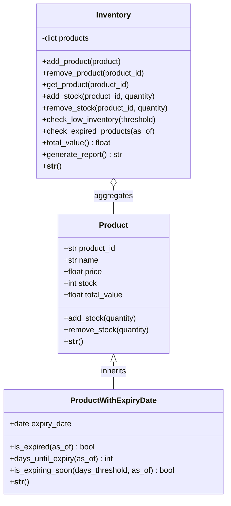

# Inventory Management System

An object-oriented inventory system in Python designed to manage products, validate stock updates, track shelf life, and generate inventory summaries.

## Architecture



## Features

- Attribute validation via `@property` getters and setters (blocks negative prices, negative stock, and empty identifiers).
- Expiration tracking with `ProductWithExpiryDate` to identify expired products and items approaching shelf-life limits.
- Stock adjustments with bounds checking to prevent stock depletion below zero.
- Inventory queries including low-stock alerts, expiration checks, and total valuation.
- Clean string representations via `__str__` for logging and inspection.

## Usage

```python
from datetime import date
from inventory import Inventory, Product, ProductWithExpiryDate

# Initialize inventory
inv = Inventory()

# Add standard and perishable products
p1 = Product("P01", "Mechanical Keyboard", 79.99, stock=12)
p2 = ProductWithExpiryDate("P02", "Whole Milk", 3.49, stock=4, expiry_date=date(2026, 12, 1))

inv.add_product(p1)
inv.add_product(p2)

# Adjust stock
inv.add_stock("P01", 5)
inv.remove_stock("P02", 2)

# Print inventory report with low-stock and expiration alerts
print(inv.generate_report(low_stock_threshold=5))
```

## Running tests

Run the test suite with pytest:

```bash
pytest test_inventory.py
```
