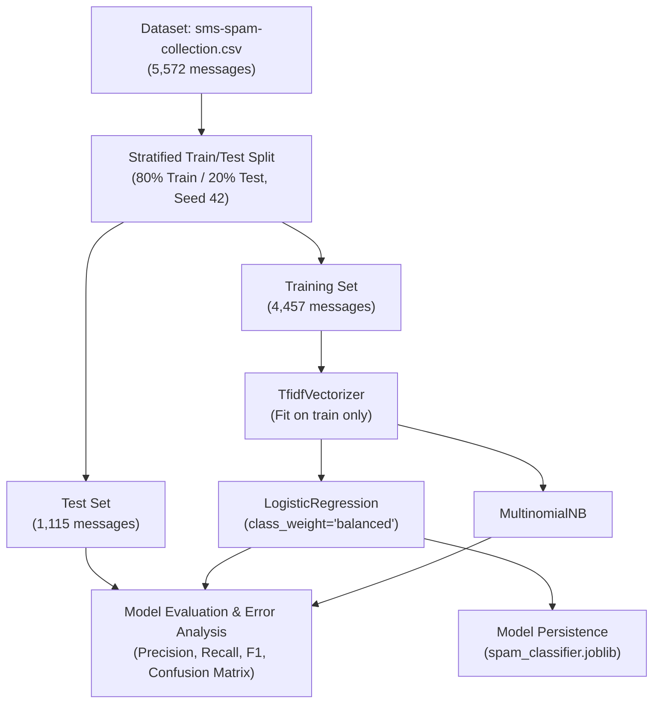

# SMS Spam Classification Pipeline

A text-classification pipeline that separates unwanted messages (spam) from legitimate messages (ham) using TF-IDF feature extraction and machine learning classifiers.

## Architecture



## Dataset and attribution

- Source: [SMS Spam Collection](https://huggingface.co/datasets/codesignal/sms-spam-collection) via Hugging Face, licensed under Creative Commons Attribution 4.0 International (CC BY 4.0).
- Columns used: `label` (target: `ham` or `spam`) and `message` (raw text).
- Total samples: 5,572 messages.
- Class distribution: 4,825 legitimate messages (86.59%) and 747 spam messages (13.41%).

## Why accuracy is misleading on imbalanced datasets

With an 86.6% majority class (`ham`), an uninformative baseline model that labels every single message as legitimate achieves 86.64% raw accuracy. Despite that high score, the model catches zero spam messages (0% recall, 0% precision). 

Evaluating text filtering pipelines requires metrics focused on the minority class:
- Precision: Out of all messages flagged as spam, what proportion were actually spam (cost of false alarms).
- Recall: Out of all true spam messages, what proportion were successfully intercepted.
- F1-Score: Harmonic mean of precision and recall.

## Performance comparison

Evaluated on the 20% stratified test split (1,115 messages: 966 ham, 149 spam):

| Model | Accuracy | Spam Precision | Spam Recall | Spam F1-Score | Confusion Matrix [ham, spam] |
| :--- | :--- | :--- | :--- | :--- | :--- |
| Majority-Class Baseline | 86.64% | 0.00% | 0.00% | 0.00% | `[[966, 0], [149, 0]]` |
| Multinomial Naive Bayes | 97.04% | 100.00% | 77.85% | 87.55% | `[[966, 0], [33, 116]]` |
| Logistic Regression (Balanced) | 97.49% | 89.54% | 91.95% | 90.73% | `[[950, 16], [12, 137]]` |

### Trade-off analysis: Naive Bayes vs. Logistic Regression

- Multinomial Naive Bayes acts as a conservative filter. It produced zero false positives (100% precision), ensuring no personal messages were misclassified. However, it missed 33 spam messages (77.85% recall).
- Logistic Regression with balanced class weights penalizes missed spam more heavily. It achieved 91.95% recall (missing only 12 spam messages), with a trade-off of 16 false positives on legitimate messages containing promotional vocabulary.

## Error analysis

Inspecting the misclassified messages highlights two primary linguistic patterns:

1. False Positives (legitimate messages flagged as spam):
   - Everyday conversational texts asking about message delivery or chat applications (for example, `"Did u receive my msg?"` or `"I'm always on yahoo messenger now..."`). Words like `msg` and `messenger` have high TF-IDF weights in promotional messages.

2. False Negatives (spam missed by the model):
   - Conversational preambles designed to mimic personal texts: `"Sorry I missed your call let's talk when you have the time. I'm on 07090201529"`.
   - Extremely short messages containing few distinct tokens: `"ringtoneking 84484"`.
   - Heavy slang and phonetic substitutions: `"Hi if ur lookin 4 saucy daytime fun wiv busty married woman..."`.

## Running the pipeline

Run the end-to-end Python script:

```bash
python pipeline.py
```

Run tests with pytest:

```bash
pytest test_pipeline.py
```

The trained scikit-learn pipeline is exported to `spam_classifier.joblib` for reuse.
